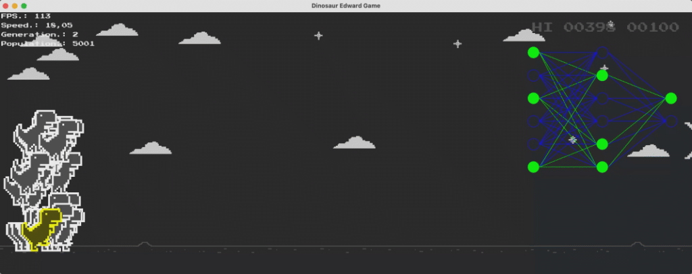

# Dinosaur Edward Game

**English** | [Português](README.pt-BR.md)



Dinosaur Edward Game is a game based on the popular Chrome dinosaur game, developed in Java 25. 
The game's core logic, including physics and rendering, was built from scratch without relying on external game engines. 
To streamline the development process, the project is assisted by modern tools like Spring Boot for simplified builds and packaging, and Lombok for code conciseness.

## Download the Game

To try out the game, download the version compatible with your operating system:

- [Download for macOS (AArch64)](https://github.com/edwarddn/dinosaur-edward-game/releases/download/v3.2.0/dinosaur-edward-game-3.2.0.dmg)
- [Download for Windows (x64)](https://github.com/edwarddn/dinosaur-edward-game/releases/download/v3.2.0/dinosaur-edward-game-3.2.0.exe)
- Download for Linux (x64):
  - [Debian based distributions (deb)](https://github.com/edwarddn/dinosaur-edward-game/releases/download/v3.2.0/dinosaur-edward-game-3.2.0.deb)
  - [Red Hat based distributions (rpm)](https://github.com/edwarddn/dinosaur-edward-game/releases/download/v3.2.0/dinosaur-edward-game-3.2.0.rpm)
  - [Arch Linux based distributions (pkg.tar.zst)](https://github.com/edwarddn/dinosaur-edward-game/releases/download/v3.2.0/dinosaur-edward-game-3.2.0-x86_64.pkg.tar.zst)
  - [Any distribution (tar.gz)](https://github.com/edwarddn/dinosaur-edward-game/releases/download/v3.2.0/dinosaur-edward-game-3.2.0-linux-x64.tar.gz)

After downloading, simply run the downloaded file on your operating system to install the game.

On Arch Linux based distributions, install the package with `sudo pacman -U ./dinosaur-edward-game-3.2.0-x86_64.pkg.tar.zst`.
With the `tar.gz`, extract it and run `dinosaur-edward-game/bin/dinosaur-edward-game`.

Enjoy the game and have fun!

## Main Features

- The game is inspired by the Chrome dinosaur game (T-rex).
- The core gameplay and rendering engine were built from scratch in Java 25.
- Features an artificial intelligence based on a neural network trained by a genetic algorithm.
- Uses Spring Boot and Lombok to streamline development and builds.

## How to Play

- Use the arrow keys for jumping or crouching to avoid enemies.
- Keep the dinosaur alive for as long as possible.
- For every enemy avoided, your score will increase.

## Game Mode Against the Artificial Intelligence

1. After starting the game, select the "Play versus Artificial Intelligence" option in the main menu.
2. Use the arrow keys to control the dinosaur.
3. Try to avoid enemies and survive for as long as possible.
4. Your score will be displayed in the top right corner.

## Artificial Intelligence Training Mode

1. After starting the game, select the "Train the Artificial Intelligence" option in the main menu.
2. The neural network will undergo a training process using a genetic algorithm.
3. The training progress will be displayed in the top right corner.
4. At the end of the training, the weights of the neural network will be saved for future use.

## System Requirements

- Java Development Kit (JDK) 25

## How to Run the Game

1. Make sure you have Java 25 installed on your system.
2. Clone this repository to your development environment.
3. Navigate to the root directory of the project.
4. Run the following commands in the terminal to compile and execute the game:

```bash
./mvnw clean install
./mvnw spring-boot:run
```

## Generating a Final Installable Version

If you are a developer and want to generate a final installable version of the game for different platforms, follow the instructions below:

**Note**: Application packages must be built on the target platform. The system used for packaging must contain the application, a JDK, and software needed by the packaging tool.

### macOS

Run the following command:

```bash
./mvnw clean install -P macos
```

This will create a `dinosaur-edward-game.dmg` file in the `target/output` folder.

### Linux

The `linux` profile builds every Linux format from the same app-image (the game with an embedded Java runtime), except Flatpak:
- the `package` phase builds only the app-image, in the `target/app-image/dinosaur-edward-game` folder, and works on any distribution;
- the `install` phase also builds the `.deb` and `.rpm` packages, in the `target/output` folder.

#### App-image (any distribution)

```bash
./mvnw clean package -P linux
target/app-image/dinosaur-edward-game/bin/dinosaur-edward-game
```

#### Debian (deb) and Red Hat (rpm)

```bash
./mvnw clean install -P linux
```

This will create the `dinosaur-edward-game.deb` and `dinosaur-edward-game.rpm` files in the `target/output` folder. It requires fakeroot and rpmbuild; on Debian based distributions, install them with `sudo apt install fakeroot rpm`.

#### Arch Linux (pkg.tar.zst)

The `.pkg.tar.zst` package is built by the Release workflow: it packs the app-image with `packaging/arch/PKGBUILD` inside an Arch Linux container and attaches the package to the release, together with a `.tar.gz` of the app-image.

To build and install it locally (the version in the file name must match `pkgver` in the `PKGBUILD`):

```bash
./mvnw clean package -P linux
tar -C target/app-image -czf packaging/arch/dinosaur-edward-game-3.2.0-linux-x64.tar.gz dinosaur-edward-game
cp packaging/linux/dinosaur-edward-game.desktop packaging/linux/dinosaur-edward-game.png LICENSE THIRD_PARTY_NOTICES.md packaging/arch/
cd packaging/arch
makepkg -f
sudo pacman -U ./dinosaur-edward-game-3.2.0-1-x86_64.pkg.tar.zst
```

#### Flatpak

Install Flatpak Builder from Flathub:

```bash
flatpak install flathub org.flatpak.Builder
```

Build the jar, then build and install the Flatpak for the current user:

```bash
./mvnw clean package
cd packaging/flatpak
flatpak run org.flatpak.Builder --user --install --install-deps-from=flathub --force-clean build-dir io.github.edwarddn.DinosaurEdwardGame.yml
flatpak run io.github.edwarddn.DinosaurEdwardGame
```

### Windows

Run the following command:

```bash
./mvnw clean install -P windows
```

This will create a `dinosaur-edward-game.exe` file in the `target/output` folder.

After following these instructions, you will have the final installable versions for each platform, ready to be distributed or shared with users.

**Important**: Remember to build the application packages on the target platform to ensure compatibility. The system used for packaging must contain the application, a JDK, and the software needed by the packaging tool for each specific platform.

The following platforms and formats are supported with the required software:
- Linux: deb, rpm, app-image (tar.gz), Arch package (pkg.tar.zst) and Flatpak
  - fakeroot and rpmbuild are required to build the deb and rpm.
  - For Flatpak, Flatpak Builder is required.
- macOS: dmg
  - Xcode command line tools are required.
- Windows: exe
  - WiX 3.0 or later is required.

## Credits

The Dinosaur Edward Game was developed by [Edward](https://github.com/edwarddn).

## Acknowledgements

I would like to express my gratitude to the Chrome browser's dinosaur game project for serving as inspiration.
I would also like to thank Spring Boot and Lombok for making my life easier.
Lastly, heartfelt thanks go to my dear and beloved wife.

## Contribution

Contributions are welcome! If you would like to contribute to the Dinosaur Edward Game, please feel free to submit a pull request.

## License

This project is licensed under the [MIT License](LICENSE).

The look of the dinosaur, the obstacles and the sound effects are inspired by the offline dinosaur game
of Google Chrome (Chromium project, © The Chromium Authors, BSD-3-Clause).
This project is not affiliated with or endorsed by Google. See [THIRD_PARTY_NOTICES.md](THIRD_PARTY_NOTICES.md).
