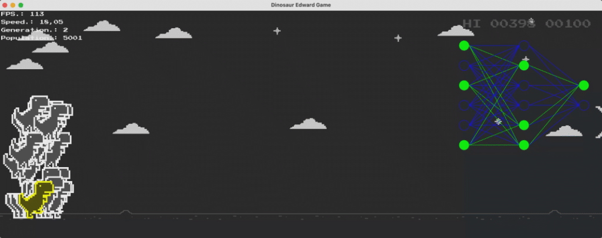

# Dinosaur Edward Game

[English](README.md) | **Português**



Dinosaur Edward Game é um jogo baseado no famoso jogo do dinossauro do Chrome, desenvolvido em Java 25.
A lógica central do jogo, incluindo a física e a renderização, foi construída do zero, sem depender de engines de jogos externas.
Para agilizar o desenvolvimento, o projeto conta com ferramentas modernas como o Spring Boot, que simplifica o build e o empacotamento, e o Lombok, que deixa o código mais conciso.

## Baixe o Jogo

Para experimentar o jogo, baixe a versão compatível com o seu sistema operacional:

- [Baixar para macOS (AArch64)](https://github.com/edwarddn/dinosaur-edward-game/releases/download/v3.2.0/dinosaur-edward-game-3.2.0.dmg)
- [Baixar para Windows (x64)](https://github.com/edwarddn/dinosaur-edward-game/releases/download/v3.2.0/dinosaur-edward-game-3.2.0.exe)
- Baixar para Linux (x64):
  - [Distribuições baseadas no Debian (deb)](https://github.com/edwarddn/dinosaur-edward-game/releases/download/v3.2.0/dinosaur-edward-game-3.2.0.deb)
  - [Distribuições baseadas no Red Hat (rpm)](https://github.com/edwarddn/dinosaur-edward-game/releases/download/v3.2.0/dinosaur-edward-game-3.2.0.rpm)
  - [Distribuições baseadas no Arch Linux (pkg.tar.zst)](https://github.com/edwarddn/dinosaur-edward-game/releases/download/v3.2.0/dinosaur-edward-game-3.2.0-x86_64.pkg.tar.zst)
  - [Qualquer distribuição (tar.gz)](https://github.com/edwarddn/dinosaur-edward-game/releases/download/v3.2.0/dinosaur-edward-game-3.2.0-linux-x64.tar.gz)

Depois de baixar, basta executar o arquivo no seu sistema operacional para instalar o jogo.

Em distribuições baseadas no Arch Linux, instale o pacote com `sudo pacman -U ./dinosaur-edward-game-3.2.0-x86_64.pkg.tar.zst`.
Com o `tar.gz`, extraia o arquivo e rode `dinosaur-edward-game/bin/dinosaur-edward-game`.

Divirta-se!

## Principais Funcionalidades

- O jogo é inspirado no jogo do dinossauro do Chrome (T-rex).
- A jogabilidade e o motor de renderização foram construídos do zero em Java 25.
- Conta com uma inteligência artificial baseada em uma rede neural treinada por um algoritmo genético.
- Usa Spring Boot e Lombok para agilizar o desenvolvimento e o build.

## Como Jogar

- Use as setas do teclado para pular ou abaixar e desviar dos inimigos.
- Mantenha o dinossauro vivo pelo maior tempo possível.
- A cada inimigo evitado, a sua pontuação aumenta.

## Modo de Jogo Contra a Inteligência Artificial

1. Depois de iniciar o jogo, selecione a opção "Play versus Artificial Intelligence" no menu principal.
2. Use as setas do teclado para controlar o dinossauro.
3. Tente desviar dos inimigos e sobreviver pelo maior tempo possível.
4. A sua pontuação aparece no canto superior direito.

## Modo de Treinamento da Inteligência Artificial

1. Depois de iniciar o jogo, selecione a opção "Train the Artificial Intelligence" no menu principal.
2. A rede neural passará por um processo de treinamento usando um algoritmo genético.
3. O progresso do treinamento aparece no canto superior direito.
4. Ao final do treinamento, os pesos da rede neural são salvos para uso futuro.

## Requisitos do Sistema

- Java Development Kit (JDK) 25

## Como Executar o Jogo

1. Certifique-se de ter o Java 25 instalado no seu sistema.
2. Clone este repositório no seu ambiente de desenvolvimento.
3. Entre na pasta raiz do projeto.
4. Execute os comandos abaixo no terminal para compilar e rodar o jogo:

```bash
./mvnw clean install
./mvnw spring-boot:run
```

## Gerando uma Versão Final Instalável

Se você é desenvolvedor e quer gerar uma versão final instalável do jogo para as diferentes plataformas, siga as instruções abaixo:

**Observação**: os pacotes da aplicação precisam ser gerados na plataforma de destino. O sistema usado para empacotar precisa ter a aplicação, um JDK e o software exigido pela ferramenta de empacotamento.

### macOS

Execute o comando:

```bash
./mvnw clean install -P macos
```

Isso vai criar um arquivo `dinosaur-edward-game.dmg` na pasta `target/output`.

### Linux

O perfil `linux` gera todos os formatos de Linux a partir do mesmo app-image (o jogo com um Java embutido), com exceção do Flatpak:
- a fase `package` gera só o app-image, na pasta `target/app-image/dinosaur-edward-game`, e funciona em qualquer distribuição;
- a fase `install` gera também os pacotes `.deb` e `.rpm`, na pasta `target/output`.

#### App-image (qualquer distribuição)

```bash
./mvnw clean package -P linux
target/app-image/dinosaur-edward-game/bin/dinosaur-edward-game
```

#### Debian (deb) e Red Hat (rpm)

```bash
./mvnw clean install -P linux
```

Isso vai criar os arquivos `dinosaur-edward-game.deb` e `dinosaur-edward-game.rpm` na pasta `target/output`. É necessário ter o fakeroot e o rpmbuild; em distribuições baseadas no Debian, instale com `sudo apt install fakeroot rpm`.

#### Arch Linux (pkg.tar.zst)

O pacote `.pkg.tar.zst` é gerado pelo workflow de Release: ele empacota o app-image com o `packaging/arch/PKGBUILD` dentro de um container do Arch Linux e anexa o pacote ao release, junto com um `.tar.gz` do app-image.

Para gerar e instalar localmente (a versão no nome do arquivo precisa ser igual ao `pkgver` do `PKGBUILD`):

```bash
./mvnw clean package -P linux
tar -C target/app-image -czf packaging/arch/dinosaur-edward-game-3.2.0-linux-x64.tar.gz dinosaur-edward-game
cp packaging/linux/dinosaur-edward-game.desktop packaging/linux/dinosaur-edward-game.png LICENSE THIRD_PARTY_NOTICES.md packaging/arch/
cd packaging/arch
makepkg -f
sudo pacman -U ./dinosaur-edward-game-3.2.0-1-x86_64.pkg.tar.zst
```

#### Flatpak

Instale o Flatpak Builder pelo Flathub:

```bash
flatpak install flathub org.flatpak.Builder
```

Gere o jar e depois compile e instale o Flatpak para o usuário atual:

```bash
./mvnw clean package
cd packaging/flatpak
flatpak run org.flatpak.Builder --user --install --install-deps-from=flathub --force-clean build-dir io.github.edwarddn.DinosaurEdwardGame.yml
flatpak run io.github.edwarddn.DinosaurEdwardGame
```

### Windows

Execute o comando:

```bash
./mvnw clean install -P windows
```

Isso vai criar um arquivo `dinosaur-edward-game.exe` na pasta `target/output`.

Seguindo essas instruções, você terá as versões finais instaláveis de cada plataforma, prontas para distribuir ou compartilhar.

**Importante**: lembre-se de gerar os pacotes na plataforma de destino para garantir a compatibilidade. O sistema usado para empacotar precisa ter a aplicação, um JDK e o software exigido pela ferramenta de empacotamento de cada plataforma.

Plataformas e formatos suportados, com o software necessário:
- Linux: deb, rpm, app-image (tar.gz), pacote do Arch (pkg.tar.zst) e Flatpak
  - O fakeroot e o rpmbuild são necessários para gerar o deb e o rpm.
  - Para o Flatpak, é necessário o Flatpak Builder.
- macOS: dmg
  - As ferramentas de linha de comando do Xcode são necessárias.
- Windows: exe
  - É necessário o WiX 3.0 ou superior.

## Créditos

O Dinosaur Edward Game foi desenvolvido por [Edward](https://github.com/edwarddn).

## Agradecimentos

Agradeço ao projeto do jogo do dinossauro do navegador Chrome por servir de inspiração.
Agradeço também ao Spring Boot e ao Lombok por facilitarem a minha vida.
Por fim, um agradecimento de coração à minha querida e amada esposa.

## Contribuição

Contribuições são bem-vindas! Se você quiser contribuir com o Dinosaur Edward Game, fique à vontade para enviar um pull request.

## Licença

Este projeto está licenciado sob a [Licença MIT](LICENSE).

A aparência do dinossauro, dos obstáculos e os efeitos sonoros são inspirados no jogo do dinossauro offline
do Google Chrome (projeto Chromium, © The Chromium Authors, BSD-3-Clause).
Este projeto não é afiliado ao Google nem endossado por ele. Veja o [THIRD_PARTY_NOTICES.md](THIRD_PARTY_NOTICES.md).
